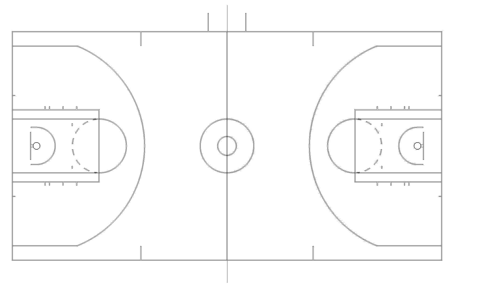

# Online Player Tracking in Basketball

An online (real-time, frame by frame) system that detects and tracks basketball players and referees in ordinary broadcast video, with no special cameras, and draws a bird's-eye view of the court for tactical analysis.

My MEng Artificial Intelligence dissertation at the University of Manchester (2023), supervised by Dr Aphrodite Galata.

## Results

| Component | Metric | Result |
|---|---|---|
| Player and referee detection | mAP50-95 | **79.44%** |
| Court detection | Recall | **99.19%** |
| Player and referee tracking | MOTA (IoU 0.8) | **98.88%** |
| Detection thresholds | F1 (NMS 0.6, confidence 0.2) | **0.89** |
| Court tracking | Mean squared error | **2.28 px** (3.39 px without edge removal) |
| Team classification | F1 | **0.990** (0.958 without the history system) |

## How it works

1. **Player and referee detection:** a YOLOv8 detector fine-tuned on a custom dataset.
2. **Court detection:** a YOLOv8 segmentation model finds the free-throw area. Douglas-Peucker polygon approximation and corner detection give its 4 corners for the homography.
3. **Player and referee tracking:** DeepSORT (Kalman filter, Hungarian assignment and a CNN appearance descriptor trained on Market-1501), with separate trackers for players and referees to avoid ID switches.
4. **Court tracking:** when the free-throw area is hidden, the court is followed with Farnebäck optical flow on Canny edges, after removing players and the scoreboard. A queue processes hidden stretches and resets the accumulated error.
5. **Team classification:** jersey crop, RGB histogram, Gaussian blur and K-means, with a 50-frame history so a team survives occlusion.
6. **Bird's-eye view:** a homography maps each player's feet onto a 2D court, coloured by team, with a unique ID.

## Data and training

- Two datasets annotated on Roboflow: about 987 player and referee images and 2,110 court images, from NBA, WNBA and Olympic broadcasts, split 70/20/10.
- Fine-tuned from COCO weights on the university's Computational Shared Facility with 2 V100 GPUs (about 2 hours, against about 2 days on a laptop).

## Code

- `main.py` runs tracking on a video, and `main-gui.py` opens the GUI.
- `utils/`: `Engine` (main loop), `Frame` (per-frame vision steps), `DeepSort` wrapper and `gui.py`.
- `deepsort/`: DeepSORT from [nwojke/deep_sort](https://github.com/nwojke/deep_sort), with team-aware track classes.
- `config.json`: every parameter (thresholds, weights paths, input and output video).

The trained weights and the videos are not in this repository.

## Running it

1. Create an environment: `conda create -yn tracking python=3.10 && conda activate tracking`
2. Install [PyTorch](https://pytorch.org/get-started/locally/) for your system.
3. `pip3 install ultralytics tensorflow scikit-learn`
4. Put your weights and input video where `config.json` points, then run `python3 main-gui.py`.

## Licence

GPL-3.0 (see `LICENSE`), as it includes GPL-3.0 code from deep_sort.
